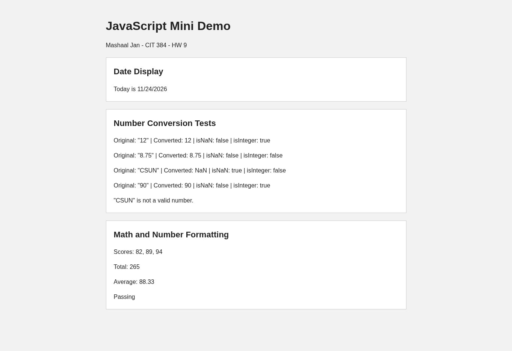

# CIT 384 - HW 9

JavaScript Mini Demo by Mashaal Jan.

[View the webpage](https://martianmashaal.github.io/cit384-hw9/)

## Built-in objects and methods

- `Date` creates an object for the current date.
- `getMonth()`, `getDate()`, and `getFullYear()` get the parts of the date.
- `Number()` converts each string into a number.
- `Number.isNaN()` checks whether a conversion produced `NaN`.
- `Number.isInteger()` checks whether a converted number is an integer.
- `toFixed(2)` formats the average with two decimal places.

## Screenshot

File path: `screenshot.jpg`

## Reflection

The easiest part was adding the three scores and dividing the total to find the average.
The hardest part was getting the date format right, including the leading zeros.
I learned that the Date object's months start at zero, so I needed to add one to the month.
I learned that Number can convert numeric strings, but a word like "CSUN" becomes NaN.
I also learned how to display JavaScript results in existing HTML elements using textContent and innerHTML.

## Extra credit

Light CSS styling separates the three sections into panels.

## Sources

- The HW 9 assignment handout.
- [MDN: Date](https://developer.mozilla.org/en-US/docs/Web/JavaScript/Reference/Global_Objects/Date)
- [MDN: Number](https://developer.mozilla.org/en-US/docs/Web/JavaScript/Reference/Global_Objects/Number)
- [MDN: toFixed()](https://developer.mozilla.org/en-US/docs/Web/JavaScript/Reference/Global_Objects/Number/toFixed)
